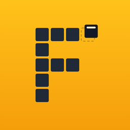
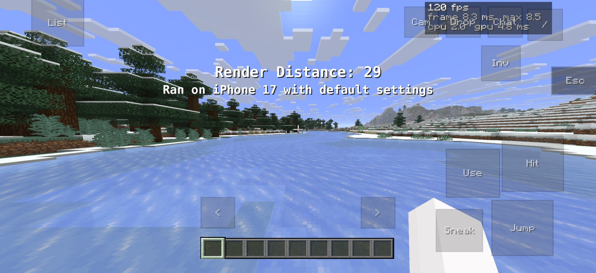
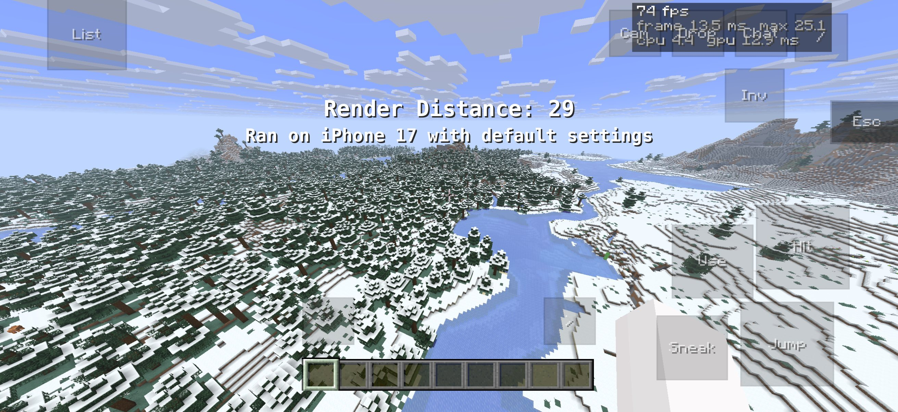

<p align="center">
  
</p>

# Ferrite

Made by [razlua](https://github.com/razlua) (@4rnz on Discord).

Minecraft: Java Edition running natively on iPhone, iPad, Android and Chromebooks, with no
streaming and no PC. Ferrite is an unofficial, experimental port of
[Horizon](https://github.com/horizon-rust/horizon), the Rust rewrite of Java Edition 26.3. Sign in
with your own Microsoft account and play single player worlds and servers with touch controls you
can rearrange.

[Install on iPhone](#installing-on-iphone-and-ipad) with Sideloadly, or add the AltStore /
SideStore source and get updates in the app:

```
https://raw.githubusercontent.com/razlua/horizon-ios/ios-port/altstore-source.json
```

[Install on Android or ChromeOS](#installing-on-android-and-chromeos) from the `.apk` on the
[releases page](https://github.com/razlua/horizon-ios/releases).

> This port isn't made, approved or supported by the Horizon project, Mojang or Microsoft. It
> contains no Minecraft code, assets or data: the app downloads your own copy of Minecraft from
> Mojang after you sign in with an account that owns Java Edition. Please report problems with
> this port here, not to upstream Horizon.

It's Horizon's own game client, built on upstream Horizon at commit `6475f62`. Upstream's README
and roadmap are kept in [docs/upstream/](docs/upstream/). It starts, signs in and plays on a
recent iPhone, but expect rough edges. See [ROADMAP.md](ROADMAP.md) and the known issues below.

## Supported devices

| Platform | Needs | Status |
|---|---|---|
| iPhone and iPad | iOS 16 or later, an A11 chip or newer (iPhone 8 / X and up), Developer Mode on | Main platform, tested on an iPhone 17 |
| Android phones and tablets | Android 10 or later, 64-bit (`arm64-v8a`), a GPU with Vulkan | Experimental, little testing on real devices |
| ChromeOS | A Chromebook with Android apps (Google Play) and a way to install an `.apk`, see below. ARM and Intel/AMD both work | Experimental. Keyboard and mouse work, with the mouse captured in the world |

All of them need a Microsoft account that owns Minecraft: Java Edition, and Wi-Fi for the first
launch (about 520 MB).

## Performance

<p align="center">
  
  
</p>

An iPhone 17 at render distance 29 with default settings: 120 fps along the river, and 74 fps
looking out over the whole view.

Launchers like PojavLauncher run the Java game in a Java virtual machine on the phone, which needs
JIT turned on to be playable. Horizon is the game rewritten in Rust and compiled for the phone,
drawing straight to Metal on iOS and Vulkan on Android, so there's no Java and no JIT to set up.
On iPhones with ProMotion it runs at the screen's full 120 Hz.

## What works

- The start screen shows from the first frame. On the first launch, after you sign in, it
  downloads and sets up the game files and shows each step, its size and any retry.
- Microsoft sign-in works without a launcher: tap Open sign-in page and the browser opens with
  your code already filled in.
- The start screen lists your saved Microsoft accounts. Tap one to play as it, or add or remove
  accounts.
- Play offline lets you pick the name you use in single player and on offline-mode servers.
- In the world, the left side of the screen is a floating move stick (push past its edge to
  sprint), the buttons on the right do the actions, and a finger anywhere else turns the view. In
  menus you tap to click, swipe to scroll, and tap with a second finger to right-click.
- A small Esc button at the top centre closes the inventory and other screens, and opens the
  pause menu in the world.
- Edit HUD takes Quit Game's place on the main menu. You can drag, add, remove and resize buttons,
  move and resize the move stick's area, and move and resize the Esc button. It keeps three
  layouts, and Reset brings back the defaults. Buttons can also press keyboard keys: hotbar slots
  1 to 9, F1, F2, F3, F3+B / G / H / N / T / F4, and `/`.
- The system keyboard opens when you tap a text box, including chat's line. Return sends a chat
  message or confirms, then closes the keyboard, and tapping anywhere else closes it too. Over
  chat, Tab completes commands and names, Paste pastes, and Enter sends.
- Copy and paste work with other apps. iOS asks before the game reads what you copied.
- Villager trading works by finger: drag the list of trades to scroll it, and tap a trade to
  pick it. Speed Trade (the >> button next to the result) keeps making the selected trade until
  you stop it or the villager runs out.
- Extra Settings (Ferrite), under Options and Edit HUD on the main menu, has the port's own
  settings: Safe Area (the HUD, menus and buttons stay clear of the Dynamic Island and the home
  bar, while backgrounds still fill the screen), button opacity, touch look speed, keeping the
  screen on, and Speed Trade's speed and mode.
- 59 native mods from [Horizon's registry](https://github.com/horizon-rust/horizon-mods) come
  built in: minimaps, Zoom, AppleSkin, Freelook, JEI, waypoints, keystrokes, HUD mods and more
  ([NATIVE_MODS.md](NATIVE_MODS.md) lists them with their licenses). They all start off. Turn on
  the ones you want in *Options → Mods*, and add a mod's key in Edit HUD (B, C, G, R, V, X, Z and
  others, marked "mods").
- Ferrite VC, the voice chat, works on servers with the Simple Voice Chat plugin or mod. You hear
  the players who use it from where they stand, and you can talk. Add its buttons in Edit HUD:
  VC opens its menu (Voice, Groups and Keys tabs), Talk sends your voice while you hold it, and
  Mic mutes and unmutes. The microphone opens the first time you talk, when the system asks for
  permission, and closes when you mute it. The client is unofficial (the engine of Horizon's
  voicechat native mod) and not affiliated with Simple Voice Chat.
- The start screen tells you when a newer version is out. On iPhone with SideStore or AltStore
  installed, Update with SideStore (or AltStore) installs it in one tap; otherwise the button
  opens the download page.
- On iPhone, saves, options, resource packs and logs are in the Files app, under
  *On My iPhone → Ferrite*.
- Profiles on the launcher's Play tab keep separate settings, keybinds and servers lists (PvP,
  survival...), with worlds, packs and mods shared.
- The game pauses and saves when you leave the app. Close, beside Extra Settings on the main
  menu (or Close Ferrite in the launcher's More), ends it.
- If Ferrite closes by itself while you play (usually iOS ending it for memory), the next start
  says so, with the render distance and memory at the time, and Send report shares what happened.

## Installing on iPhone and iPad

You need Developer Mode on (*Settings → Privacy & Security → Developer Mode*) and your own Apple
ID for signing. Pick one of the two ways below.

### AltStore or SideStore (updates in the app)

1. Have [AltStore Classic](https://altstore.io) or [SideStore](https://sidestore.io) installed
   and working. AltStore PAL, the EU version, only installs notarized apps, so it can't install
   this one.
2. Add the source. In AltStore, go to *Browse → Sources → +*. In SideStore, open *Sources → +*.
   [Feather](https://github.com/khcrysalis/Feather) takes the same source too.
   Paste this address:
   ```
   https://raw.githubusercontent.com/razlua/horizon-ios/ios-port/altstore-source.json
   ```
3. Open Ferrite in the source and tap *Free* or *Install*.

New builds show up as updates under *My Apps*. The 7-day refresh happens there too: SideStore
does it on the phone, and AltStore Classic needs AltServer running on a computer on the same
Wi-Fi.

### Sideloadly or another tool

1. Download `Horizon-unsigned.ipa` (about 30 MB) from the latest iOS
   [release](https://github.com/razlua/horizon-ios/releases/latest).
2. Sideload it with [Sideloadly](https://sideloadly.io) or your usual tool.
3. Trust your profile on the phone: *Settings → General → VPN & Device Management → your Apple ID
   → Trust*. The phone needs internet for this, and a VPN or DNS filter can block it.

With a free Apple ID the app has to be signed again every 7 days, and you can have at most 3
sideloaded apps at once.

### Refreshing inside Ferrite (experimental)

Ferrite can sign itself again and install over itself from its Refresh tab, keeping your worlds.
It needs three things, the same as SideStore:

1. A pairing file for your iPhone, made once on a computer with
   [jitterbugpair](https://github.com/osy/Jitterbug/releases). Put it in *Files → On My iPhone →
   Ferrite → pairing*.
2. LocalDevVPN, free on the App Store, turned on while you refresh.
3. Your Apple ID, signed in on the Refresh tab. Your password goes only to Apple.

Tap Test connection, then Refresh now. Ferrite closes while it installs and opens again with 7 new
days. It never removes another app's certificate, so if your Apple ID already has as many as
Apple allows, it says so instead.

## Installing on Android and ChromeOS

1. Download `Horizon.apk` from the newest "Android APK" release on the
   [releases page](https://github.com/razlua/horizon-ios/releases).
2. Open it. Android asks you to allow installs from your browser or file manager the first time.
3. Open Ferrite and sign in.

On a Chromebook, turn on Google Play first (*Settings → Apps → Google Play Store*). ChromeOS only
installs an `.apk` from outside the Play Store with Developer Mode on, or with ADB debugging
turned on under *Settings → Advanced → Developers → Linux development environment → Develop
Android apps*. Both reset the Chromebook the first time you turn them on, so back up your files
first. Once it's installed, open the `.apk` from the Files app with the Android file manager you
use (CX File Explorer works).

To update, install the new `.apk` over the old one. Your worlds and sign-ins stay. More in
[docs/android.md](https://github.com/razlua/horizon-ios/blob/android-port/docs/android.md),
including where the game folder is.

## First launch

Open Ferrite and sign in with Microsoft. The first time, the app downloads your Minecraft 26.3
from Mojang (about 520 MB) and Horizon's tables, then sets them up. Stay on Wi-Fi with Ferrite
open. After that it starts straight away, offline too.

### How the game files get there

Ferrite's preparation runs a few of Mojang's Java classes to work out data tables (blocks,
entities, collision, world generation), and a phone can't run Java. Those tables are the same for
everyone on a version, so they're worked out once and published in this repository's
`tables-<revision>` release. That release has none of Minecraft's files in it, so no textures,
sounds, models or languages. The app downloads those from Mojang once you've signed in with an
account that owns the game. It checks every file against Mojang's checksum and the tables against
the SHA-256 built into the app. The folder it ends up with is identical, file for file, to what a
computer's preparation makes.

On iPhone you can also add the game files on a computer instead. Run
`python tools/ios/add-resources.py Horizon-unsigned.ipa "<prepared folder>" Horizon.ipa` on the
folder the [Horizon launcher](https://playhorizon.dev) prepared, and sideload `Horizon.ipa`.
That app has your game files inside, so don't share it.

## Controls

Every control is on screen, and Edit HUD on the main menu moves, adds and resizes them.

On iPhone and iPad, Xbox, PlayStation, MFi and Switch Pro controllers work, with menus and the
right button pictures, and so do a hardware keyboard (as on a computer) and a mouse (look,
attack and use in the world). The touch buttons hide while you use one and come back at the next
touch. On Android and ChromeOS a keyboard and mouse work as on a computer: click into the world
to capture the mouse, and Esc or the system's Back gesture lets it go.

## Where things are

On iPhone, under *Files → On My iPhone → Ferrite*:

| Path | What it is |
|---|---|
| `saves/` | Worlds |
| `options.txt`, `resourcepacks/` | Settings and packs |
| `touch-controls.json` | Your Edit HUD layouts. Delete it to go back to the defaults |
| `ios-settings.txt` | Extra Settings (Ferrite) |
| `home/logs/latest.log` | The log. Attach it to bug reports |
| `home/crash-reports/` | Crash reports |
| `ios-*-error.txt` | Written when unpacking or starting failed |
| `resources/` | The game files |

Your Microsoft sign-ins are kept in the app's private storage, not in Files, and deleting the app
deletes them. On Android the same files are in
`Android/data/dev.playhorizon.unofficial.android/files`, and each start also writes
`Downloads/Ferrite-last-log.txt`.

## Updating

If the Get the update button sent you here: download the newest release for your device and
install it over the app you have. With SideStore or AltStore, update from *My Apps* instead.

Don't delete the app before updating. Deleting it deletes your worlds, settings and sign-ins.

## About

*Options → About the Project* says who makes this port and where to report bugs: @4rnz on Discord
(razlua on GitHub). Send bugs there, with `home/logs/latest.log` if you can.

Built with assistance from Claude (Anthropic's AI). It isn't vibecoded.

## Known issues

- Controllers, keyboards and mice are new and lightly tested. The mouse isn't locked to the game
  on iPad yet, so its pointer still moves over the screen while you look around.
- There's no narrator (text-to-speech).
- In voice chat, the phone's speaker can be heard through the microphone. Headphones, or push to
  talk, avoid the echo.
- The game draws edge to edge by default, so part of it can end up under the Dynamic Island, the
  notch or the home indicator. Turn on Safe Area in Extra Settings to keep it clear. On Android,
  Safe Area does nothing yet.
- On Android, letters outside the basic Latin set (å, ä, ö and others) may not type yet.
- Only the native mods built into the app are available: a phone can't compile or load new mod
  code. Mods made for newer Horizon versions, the mod browser, modpacks and server hosting need
  the desktop launcher.

More in [ROADMAP.md](ROADMAP.md). Changes are listed in [CHANGELOG.md](CHANGELOG.md).

## Building

Linking an iOS app needs macOS. The [iOS workflow](.github/workflows/ios.yml) builds on GitHub's
macOS runners on every push to `ios-port`:

```sh
rustup target add aarch64-apple-ios
cargo build --release --target aarch64-apple-ios -p horizon-client --bin horizon-client \
  --no-default-features --features audio
bash packaging/ios/package.sh target/aarch64-apple-ios/release/horizon-client dist/Horizon-unsigned.ipa
```

On other systems, the same command with `cargo check` type-checks the port, as long as the C
build scripts get a stand-in compiler (they want the iOS SDK). [docs/ios.md](docs/ios.md) explains
how the port fits together. The Android build lives on the `android-port` branch and builds on
GitHub's Linux runners, see
[docs/android.md](https://github.com/razlua/horizon-ios/blob/android-port/docs/android.md).

### Where the phone code is

| File | What it does |
|---|---|
| `crates/horizon-client/src/game/ios_boot.rs` | The start screen; runs the setup and the sign-in beside the event loop |
| `crates/horizon-client/src/game/ios_setup.rs` | Downloads the game files from Mojang and the tables, and puts them together |
| `crates/horizon-client/src/game/ios_account.rs` | Microsoft → Xbox Live → XSTS → Minecraft services sign-in, and the saved accounts |
| `crates/horizon-client/src/game/touch.rs` | Touch controls, the Esc button, key buttons |
| `crates/horizon-client/src/game/touch_editor.rs` | Edit HUD |
| `crates/horizon-client/src/game/trading.rs` | Trading by finger and Speed Trade |
| `crates/horizon-client/src/game/voice_chat.rs` | Ferrite VC's menu, keys, HUD and touch buttons |
| `crates/horizon-client/src/game/ios_update.rs` | Whether a newer build is out |
| `crates/horizon-client/src/ios_screen.rs` | The start screen's drawing |
| `crates/horizon-threads/src/ios_url.rs`, `ios_pasteboard.rs`, `ios_display.rs` | Opening Safari, the clipboard, the frame rate |
| `tools/ios/native-mods.py`, `native-mods.txt` | The native mods built in: fetched from the registry, checked and applied with horizon-mixins before the build |
| `packaging/ios/`, `tools/ios/` | The app bundle, adding game files on a computer, building the tables, and adding a release to the AltStore source (`altstore-version.py`) |

## Credits and license

Horizon is by Ludovic Marie and the Horizon contributors, and the whole game is theirs; this fork
adds the phone parts. Microsoft sign-in uses Cazza Launcher's Azure application. The license is
MIT, the same as upstream ([LICENSE](LICENSE)), and third-party notices are in
[THIRD_PARTY_NOTICES.md](THIRD_PARTY_NOTICES.md).

Minecraft is a trademark of Mojang Synergies AB. This project isn't affiliated with Mojang or
Microsoft.
