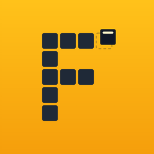
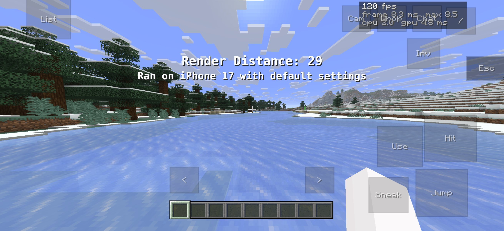
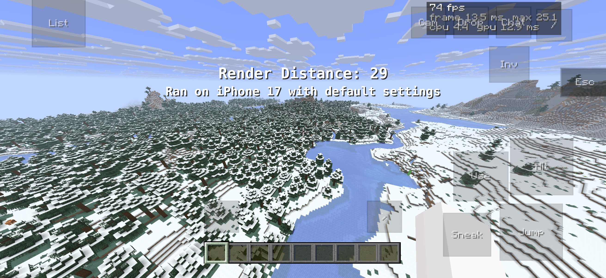

<p align="center">
  
</p>

# Ferrite

Made by [razlua](https://github.com/razlua) (@4rnz on Discord).

Minecraft: Java Edition running natively on your iPhone, with no streaming and no PC. Ferrite is
an unofficial, experimental iPhone port of [Horizon](https://github.com/horizon-rust/horizon), the
Rust rewrite of Java Edition 26.3, drawn with Metal at up to 120 Hz. Sign in with your own Microsoft
account and play single player worlds and servers with touch controls you can rearrange.

**[Install it](#installing)** with Sideloadly, or add the AltStore / SideStore source and get
updates in the app:

```
https://raw.githubusercontent.com/razlua/horizon-ios/ios-port/altstore-source.json
```

**Android:** an experimental `.apk` with the same touch HUD is on the
[releases page](https://github.com/razlua/horizon-ios/releases) (the newest "Horizon for
Android" one). It's built on the `android-port` branch; see
[docs/android.md](https://github.com/razlua/horizon-ios/blob/android-port/docs/android.md).

> This port isn't made, approved or supported by the Horizon project, Mojang or Microsoft. It
> contains no Minecraft code, assets or data: the app downloads your own copy of Minecraft from
> Mojang after you sign in with an account that owns Java Edition. Please report problems with
> this port here, not to upstream Horizon.

It's Horizon's own game client, built for `aarch64-apple-ios`, on top of upstream Horizon at
commit `6475f62`. Upstream's README and roadmap are kept in [docs/upstream/](docs/upstream/). It
starts, signs in, and plays on a recent iPhone, but expect rough edges. See
[ROADMAP.md](ROADMAP.md) and the known issues below.

## Performance

<p align="center">
  
  
</p>

An iPhone 17 at render distance 29 with default settings: 120 fps along the river, and 74 fps
looking out over the whole view.

Launchers like PojavLauncher run the Java game in a Java virtual machine on the phone, which needs
JIT turned on to be playable. Horizon is the game rewritten in Rust and compiled for the iPhone,
drawing straight to Metal, so there's no Java and no JIT to set up, and it runs at the screen's
full 120 Hz.

## What works

- The start screen shows from the first frame. On the first launch it downloads and sets up the
  game files with a progress bar, after you sign in.
- Microsoft sign-in works without a launcher: tap Open sign-in page and Safari opens with your
  code already filled in.
- The start screen lists your saved Microsoft accounts. Tap one to play as it, or add or remove
  accounts.
- Play offline lets you pick the name you use in single player and on offline-mode servers.
- In the world, the left side of the screen is a floating move stick (push past its edge to
  sprint), the buttons on the right do the actions, and a finger anywhere else turns the view. In
  menus you tap to click, swipe to scroll, and tap with a second finger to right-click.
- A small Esc button at the top centre closes the inventory and other screens, and opens the
  pause menu in the world.
- Edit HUD takes Quit Game's place on the main menu. You can drag, add, remove and resize buttons,
  move and resize the move stick's area, and move and resize the Esc button. It keeps three
  layouts, and Reset brings back the defaults. Buttons can also press keyboard keys: hotbar slots
  1 to 9, F1, F2, F3, F3+B / G / H / N / T / F4, and `/`.
- The iPhone keyboard opens when you tap a text box, including chat's line. Return sends a chat
  message or confirms, then closes the keyboard, and tapping anywhere else closes it too. Over
  chat, Tab completes commands and names, Paste pastes, and Enter sends.
- Copy and paste work with other apps. iOS asks before the game reads what you copied.
- ProMotion screens run at 120 Hz.
- Extra Settings (Ferrite), under Options and Edit HUD on the main menu, has the port's own
  settings: Safe Area (the HUD, menus and buttons stay clear of the Dynamic Island and the home
  bar, while backgrounds still fill the screen), button opacity, touch look speed, and keeping
  the screen on.
- 59 native mods from [Horizon's registry](https://github.com/horizon-rust/horizon-mods) come
  built in: minimaps, Zoom, AppleSkin, Freelook, JEI, waypoints, keystrokes, HUD mods and more
  ([NATIVE_MODS.md](NATIVE_MODS.md) lists them with their licenses). They all start off: turn on
  the ones you want in *Options → Mods*. For a mod's key, add its letter in Edit HUD (B, C, G, R,
  V, X, Z and others, marked "mods").
- Simple Voice Chat works on servers with the plugin or mod: you hear the players who use it,
  coming from where they stand, and you can talk. Add the voice chat buttons in Edit HUD: **VC**
  opens the voice chat menu (mute, voice activation or push to talk, volumes, groups), **Talk**
  sends your voice while you hold it, and **Mic** mutes and unmutes. The microphone only opens
  the first time you talk (iOS asks for permission then) and closes when you mute it. Its
  settings are also in *Options → Mods*. The client is unofficial (the engine of Horizon's
  voicechat native mod) and not affiliated with Simple Voice Chat.
- The start screen tells you when a newer version is out. With SideStore or AltStore installed,
  **Update with SideStore** (or AltStore) installs it in one tap; otherwise the button opens the
  download page.
- Saves, options, resource packs and logs are in the Files app, under *On My iPhone → Ferrite*.
- The game pauses and saves when you leave the app.

## Installing

You need an iPhone or iPad on iOS 16 or later with Developer Mode on (*Settings → Privacy &
Security → Developer Mode*), a Microsoft account that owns Minecraft: Java Edition, and your own
Apple ID for signing. Pick one of the two ways below.

### Option 1: AltStore or SideStore (updates in the app)

1. Have [AltStore Classic](https://altstore.io) or [SideStore](https://sidestore.io) installed
   and working. AltStore PAL, the EU version, only installs notarized apps, so it can't install
   this one.
2. Add the source. In AltStore, go to *Browse → Sources → +*. In SideStore, open *Sources → +*.
   Paste this address:
   ```
   https://raw.githubusercontent.com/razlua/horizon-ios/ios-port/altstore-source.json
   ```
3. Open Ferrite in the source and tap *Free* or *Install*.

When a new build comes out, it shows up as an update under *My Apps*. The 7-day refresh happens
there too: SideStore does it on the phone, and AltStore Classic needs AltServer running on a
computer on the same Wi-Fi.

### Option 2: Sideloadly (or another tool)

1. Download `Horizon-unsigned.ipa` (about 30 MB) from the latest
   [release](../../releases/latest).
2. Sideload it with [Sideloadly](https://sideloadly.io) or your usual tool.
3. Trust your profile on the phone: *Settings → General → VPN & Device Management → your Apple ID
   → Trust*. The phone needs internet for this, and a VPN or DNS filter can block it.

For updates, download the new release and sideload it over the old one. Your worlds and settings
stay.

### First launch

Open Ferrite and sign in with Microsoft. The first time, the app downloads your Minecraft 26.3
from Mojang (about 520 MB) and Horizon's tables, then sets them up. Stay on Wi-Fi with Horizon
open. After that it starts straight away, offline too.

With a free Apple ID the app has to be signed again every 7 days, and you can have at most 3
sideloaded apps at once.

### How the game files get there

Horizon's preparation runs a few of Mojang's Java classes to work out data tables (blocks,
entities, collision, world generation), and a phone can't run Java. Those tables are the same for
everyone on a version, so they're worked out once and published in this repository's
`tables-<revision>` release. That release has none of Minecraft's files in it, so no textures,
sounds, models or languages. The app downloads those from Mojang once you've signed in with an
account that owns the game. It checks every file against Mojang's checksum and the tables against
the SHA-256 built into the app. The folder it ends up with is identical, file for file, to what a
computer's preparation makes.

You can also add the game files on a computer instead. Run
`python tools/ios/add-resources.py Horizon-unsigned.ipa "<prepared folder>" Horizon.ipa` on the
folder the [Horizon launcher](https://playhorizon.dev) prepared, and sideload `Horizon.ipa`.
That app has your game files inside, so don't share it.

## Controls

| Where | Do | What happens |
|---|---|---|
| World | Thumb on the left side | Move. Push past the edge to sprint |
| World | Drag anywhere else | Look around |
| World | Jump, Sneak, Use, Hit | Jump, sneak, use or place, attack or mine. Drag a button to aim while holding it |
| World | Inv, Chat, Drop, Cam, `<` `>` | Inventory, chat, drop item, camera, hotbar left and right |
| Anywhere | Esc (top centre) | Same as the Escape key |
| Chat | Tab, Paste, Enter (top right) | Complete, paste, send |
| Chat | Tap the line at the bottom | Type again |
| Menus | Tap | Click |
| Menus | Swipe up or down | Scroll |
| Menus | Drag sideways, or hold then drag | Drag sliders and items |
| Menus | Second finger tap | Right-click |
| Main menu | Edit HUD | Change the touch buttons |
| World | VC, Talk, Mic (add them in Edit HUD) | Voice chat menu, talk while held, mute |

## Where things are

On the phone, under *Files → On My iPhone → Ferrite*:

| Path | What it is |
|---|---|
| `saves/` | Worlds |
| `options.txt`, `resourcepacks/` | Settings and packs |
| `touch-controls.json` | Your Edit HUD layouts. Delete it to go back to the defaults |
| `ios-settings.txt` | Extra Settings (Ferrite) |
| `home/logs/latest.log` | The log. Attach it to bug reports |
| `home/crash-reports/` | Crash reports |
| `ios-*-error.txt` | Written when unpacking or starting failed |
| `resources/` | The game files |

Your Microsoft sign-ins are kept in the app's private storage, not in Files, and deleting the app
deletes them.

## Updating

The "Get Update" page likely sent you here.

Updating step-by-step (Not with SideStore, altstore, etc. Made for stuff like Sideloadly): 

- Download the latest release from this github repo
- Sideload it
- Done!

NOTE: Do __NOT__ uninstall the app before updating. Doing so WILL result in a permanent loss of data.

## About

*Options → About the Project* says who makes this port and where to report bugs. That's @4rnz on
Discord (razlua on GitHub). Send bugs there, with `home/logs/latest.log` if you can.

Built with assistance from Claude (Anthropic's AI). It isn't vibecoded: I decide what goes in, test
every build on my own phone, and track down what's broken from playing it.

## Known issues

- Paired game controllers aren't read yet.
- There's no narrator (text-to-speech).
- In voice chat, the phone's speaker can be heard through the microphone. Headphones, or push to
  talk, avoid the echo.
- The game draws edge to edge by default, so part of it can end up under the Dynamic Island, the
  notch or the home indicator. Turn on Safe Area in Extra Settings to keep it clear.
- Only the native mods built into the app are available: an iPhone can't compile or load new
  mod code. Mods made for newer Horizon versions, the mod browser, modpacks and server hosting
  need the desktop launcher.

More in [ROADMAP.md](ROADMAP.md). Changes are listed in [CHANGELOG.md](CHANGELOG.md).

## Building

Linking an iOS app needs macOS. The [iOS workflow](.github/workflows/ios.yml) builds on GitHub's
macOS runners on every push to `ios-port`:

```sh
rustup target add aarch64-apple-ios
cargo build --profile fast --target aarch64-apple-ios -p horizon-client --bin horizon-client \
  --no-default-features --features audio,system-allocator
bash packaging/ios/package.sh target/aarch64-apple-ios/fast/horizon-client dist/Horizon-unsigned.ipa
```

On other systems, the same command with `cargo check` type-checks the port, as long as the C
build scripts get a stand-in compiler (they want the iOS SDK). [docs/ios.md](docs/ios.md) explains
how the port fits together.

### Where the iOS code is

| File | What it does |
|---|---|
| `crates/horizon-client/src/game/ios_boot.rs` | The start screen; runs the setup and the sign-in beside the event loop |
| `crates/horizon-client/src/game/ios_setup.rs` | Downloads the game files from Mojang and the tables, and puts them together |
| `crates/horizon-client/src/game/ios_account.rs` | Microsoft → Xbox Live → XSTS → Minecraft services sign-in, and the saved accounts |
| `crates/horizon-client/src/game/touch.rs` | Touch controls, the Esc button, key buttons |
| `crates/horizon-client/src/game/touch_editor.rs` | Edit HUD |
| `crates/horizon-client/src/game/voice_chat.rs` | Simple Voice Chat's menu, keys, HUD and touch buttons |
| `crates/horizon-client/src/game/ios_update.rs` | Whether a newer build is out |
| `crates/horizon-client/src/ios_screen.rs` | The start screen's drawing |
| `crates/horizon-threads/src/ios_url.rs`, `ios_pasteboard.rs`, `ios_display.rs` | Opening Safari, the clipboard, the frame rate |
| `tools/ios/native-mods.py`, `native-mods.txt` | The native mods built in: fetched from the registry, checked and applied with horizon-mixins before the build |
| `packaging/ios/`, `tools/ios/` | The app bundle, adding game files on a computer, building the tables, and adding a release to the AltStore source (`altstore-version.py`) |

## Credits and license

Horizon is by Ludovic Marie and the Horizon contributors, and the whole game is theirs; this fork
adds the iOS parts. Microsoft sign-in uses Cazza Launcher's Azure application. The license is
MIT, the same as upstream ([LICENSE](LICENSE)), and third-party notices are in
[THIRD_PARTY_NOTICES.md](THIRD_PARTY_NOTICES.md).

Minecraft is a trademark of Mojang Synergies AB. This project isn't affiliated with Mojang or
Microsoft.
